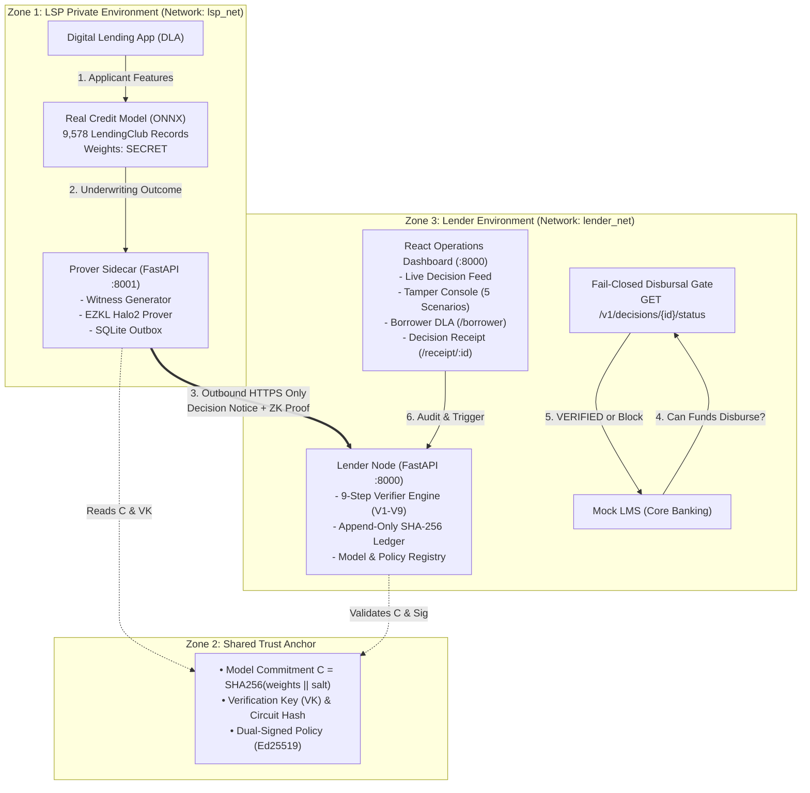
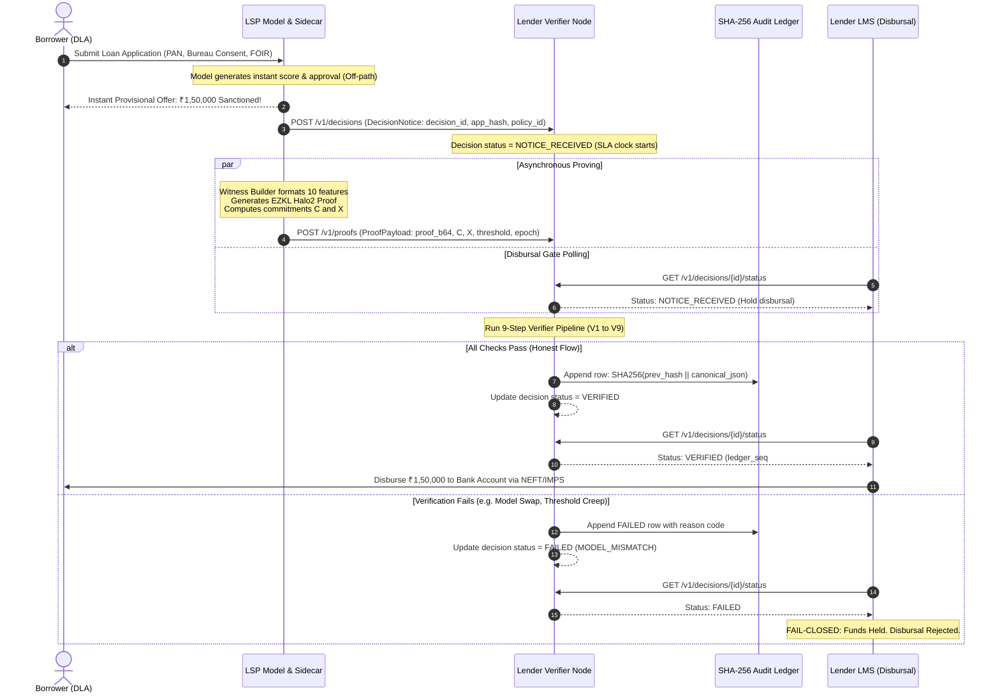

<div align="center">

# 🛡️ SAKSHI (साक्षी)
### Zero-Knowledge Contract-Conformance Assurance for Digital Lending
**Verifying credit underwriting compliance for 100% of loans without exposing proprietary model IP**

[](https://www.python.org/downloads/)
[](https://fastapi.tiangolo.com)
[](https://reactjs.org/)
[](https://ezkl.zkonduit.com/)
[](https://rbi.org.in/)

</div>

---

## 🚀 Deployment Guide (Start Here)

> **Two access methods:**
> - **College Intranet / LAN:** `http://172.20.88.119:8000` (accessible to anyone on the same network)
> - **Public Internet:** via ngrok tunnel URL
>
> All commands are written for a **Kali Linux VPS** (or any Debian/Ubuntu-based Linux VM).

### Prerequisites — One-Time Setup on the VM

```bash
# 1. Install Docker Engine
curl -fsSL https://get.docker.com | sh
sudo usermod -aG docker $USER
newgrp docker                          # Apply group without logout

# 2. Install Docker Compose v2
sudo apt-get install -y docker-compose-plugin
docker compose version                 # Verify: Docker Compose version v2.x.x

# 3. Install Python 3 + pip (for the reset script)
sudo apt-get install -y python3 python3-pip
pip3 install httpx

# 4. Install ngrok
curl -sSL https://ngrok-agent.s3.amazonaws.com/ngrok.asc \
  | sudo tee /etc/apt/trusted.gpg.d/ngrok.asc >/dev/null
echo "deb https://ngrok-agent.s3.amazonaws.com buster main" \
  | sudo tee /etc/apt/sources.list.d/ngrok.list
sudo apt-get update && sudo apt-get install -y ngrok

# 5. Authenticate ngrok (get token from https://dashboard.ngrok.com/get-started/your-authtoken)
ngrok config add-authtoken <YOUR_NGROK_AUTHTOKEN>
```

---

### Step 1 — Clone the Repository

```bash
git clone https://github.com/Anshuman-VR/Sakshi.git
cd Sakshi
```

---

### Step 2 — Build & Start the Containers

```bash
# Build both container images and start them in detached mode
docker compose -f deploy/docker-compose.yml up -d --build
```

This single command:
- Builds **`sakshi-lender`** (Verifier Node + Audit Ledger + React Dashboard + Mock LMS) and binds it to `0.0.0.0:8000`
- Builds **`sakshi-lsp`** (Private Halo2 Prover Sidecar) on the internal Docker network only — **zero public ports**
- Runs health checks every 10 seconds; both containers will show **(healthy)** within ~30 seconds

Watch the startup progress:
```bash
docker compose -f deploy/docker-compose.yml logs -f
```

Verify both containers are healthy:
```bash
docker compose -f deploy/docker-compose.yml ps
# Expected:
# NAME            STATUS                   PORTS
# sakshi-lender   Up X minutes (healthy)   0.0.0.0:8000->8000/tcp
# sakshi-lsp      Up X minutes (healthy)   (no public ports)
```

---

### Step 3 — Seed the Database with Demo Data

```bash
python3 scripts/reset_demo.py
# Expected output:
# [RESET] HTTP 200: Database reset and seeded with initial baseline record.
#         Baseline Decision ID: QL_XXXXXXXX
#         Ledger Height: #1
```

You can also click **"Reset & Seed DB"** on any portal in the UI to reseed at any time.

---

### Step 4 — Access via College Intranet (LAN)

Anyone on the same college WiFi/LAN network can open:

| Portal | URL |
| :--- | :--- |
| **Lender Dashboard** | `http://172.20.88.119:8000` |
| **Borrower Portal** | `http://172.20.88.119:8000/borrower` |
| **Demo Lab (7 Scenarios)** | `http://172.20.88.119:8000/demo` |
| **Audit Ledger Explorer** | `http://172.20.88.119:8000/ledger` |
| **LSP Partner Portal** | `http://172.20.88.119:8000/lsp` |
| **API Docs (Swagger UI)** | `http://172.20.88.119:8000/docs` |
| **Health Check** | `http://172.20.88.119:8000/healthz` |

---

### Step 5 — Expose to the Public Internet via ngrok

Open a **second terminal** on the VM (leave containers running in the first):

```bash
ngrok http 8000
```

ngrok will display:
```
Forwarding   https://abcd-1234-efgh.ngrok-free.app -> http://localhost:8000
```

The entire Sakshi suite is now publicly accessible at that URL. All portals work identically through the tunnel.

> **Tip — Persistent static ngrok domain (same URL every session):**
> ```bash
> ngrok http --domain=your-reserved-domain.ngrok-free.app 8000
> ```
> Reserve a free static domain at: https://dashboard.ngrok.com/domains

---

### Container Control — Quick Reference

```bash
# Stop containers (preserves database volumes)
docker compose -f deploy/docker-compose.yml down

# Stop AND wipe all persistent data (full clean slate)
docker compose -f deploy/docker-compose.yml down -v

# Rebuild after code changes
git pull origin main
docker compose -f deploy/docker-compose.yml up -d --build
python3 scripts/reset_demo.py

# View live logs (both containers)
docker compose -f deploy/docker-compose.yml logs -f

# View logs for one container
docker compose -f deploy/docker-compose.yml logs -f sakshi-lender
docker compose -f deploy/docker-compose.yml logs -f sakshi-lsp

# Restart a single container without full rebuild
docker compose -f deploy/docker-compose.yml restart sakshi-lender

# Open interactive shell inside lender container (for debugging)
docker exec -it sakshi-lender bash
```

---

## 📌 Executive Summary

Under the **Reserve Bank of India (Digital Lending) Directions, 2025** and the **FREE-AI Framework**, the Regulated Entity (RE — Bank or NBFC) is held **100% accountable** for credit decisions, fair practices code adherence, and model conduct. 

However, Lending Service Providers (LSPs — fintech apps like Navi, KreditBee, Slice) own the underwriting algorithms and treat their model weights and alternative feature binning formulas as **confidential intellectual property**. 

### The Problem: The Accountability Asymmetry
Lenders carry full regulatory liability for algorithmic decisions they cannot see. Current quarterly audits only sample ~0.1% of loans weeks after disbursal, leaving lenders blind to:
1. **Silent Model Swaps:** LSP deploys unapproved model variants to chase monthly originations.
2. **Threshold Creep:** LSP quietly lowers cut-offs (e.g. from 0.20 to 0.05) to hit loan volume quotas.
3. **Input Manipulation:** Agent or frontend feature inflation.
4. **Multi-RE Model Contamination:** Reusing a single model across multiple bank balance sheets.

### The Solution: Zero-Knowledge Contract Conformance
**Sakshi** allows the LSP to prove cryptographically, for **100% of individual credit decisions**, that the contractually agreed underwriting model and cut-off thresholds were executed on committed applicant data:
$$\text{"Model with commitment } C \text{ on inputs } X \text{ produced decision } D \ge \text{threshold } T\text{"}$$
- **Proving runs asynchronously inside the LSP VPC** in seconds.
- **The Lender Node verifies the proof in <20 milliseconds**.
- **The Fail-Closed Gate Rule:** The lender's Loan Management System (LMS) strictly holds loan disbursal unless the proof passes (`no proof, no disbursal`).
- **Zero IP Leakage:** Weights, hyper-parameters, private salts, and unmasked raw applicant data never cross the LSP boundary.

---

## 👥 Team Developer Assignments & Poka-Yoke Prompts

The codebase is partitioned into mutually disjoint directories so each developer's AI agent can generate working code in a single pass without merge conflicts.

```
                  [main] (Production Submission)
                     ▲
                     │ (Single-pass merge in Hour 22)
                     │
                 [develop] (Integration Base)
               ▲     ▲     ▲
               │     │     │
  ┌────────────┴┐    │     └────────────┐
  │                  │                  │
[branch-1]      [branch-2]          [branch-3]
(ZK/ML Core)    (Lender Node)      (Frontend/Orch)
Dev 1 & Dev 4   Dev 2              Dev 3
```

| Developer | Branch | Assigned File / Prompt | Owned Directories | Verification Command |
| :--- | :--- | :--- | :--- | :--- |
| **Dev 4**<br>*(Credit Risk & ML)* | `feature/branch-1-zkml-core` | [`DEV4_PROMPT.md`](./DEV4_PROMPT.md) | `model/` | `python -m pytest tests/test_model.py -v` |
| **Dev 1**<br>*(ZK Cryptography)* | `feature/branch-1-zkml-core` | [`DEV1_PROMPT.md`](./DEV1_PROMPT.md) | `circuits/`, `sidecar/`, `policy/` | `python -m pytest tests/test_circuit.py -v` |
| **Dev 2**<br>*(Lender Backend)* | `feature/branch-2-lender-node` | [`DEV2_PROMPT.md`](./DEV2_PROMPT.md) | `node/` | `python -m pytest tests/test_verifier.py -v` |
| **Dev 3**<br>*(Frontend & DevOps)* | `feature/branch-3-frontend-demo` | [`DEV3_PROMPT.md`](./DEV3_PROMPT.md) | `dashboard/`, `mock_lms/`, `deploy/`, `scripts/` | `cd dashboard && npm run build` |

---

## 🚀 Quick Start for Each Developer (How to Work)

### Step 1: Clone and Checkout Your Branch
```bash
# Clone the repository
git clone https://github.com/Anshuman-VR/Sakshi.git
cd Sakshi

# Checkout your assigned branch:
# Dev 1 & Dev 4:
git checkout feature/branch-1-zkml-core

# Dev 2:
git checkout feature/branch-2-lender-node

# Dev 3:
git checkout feature/branch-3-frontend-demo
```

### Step 2: Feed Your Prompt to Your AI Coding Agent
- Open your AI coding assistant (Claude, Cursor, Antigravity, etc.).
- Provide the complete contents of your assigned prompt file:
  - Dev 4 ➡️ `DEV4_PROMPT.md`
  - Dev 1 ➡️ `DEV1_PROMPT.md`
  - Dev 2 ➡️ `DEV2_PROMPT.md`
  - Dev 3 ➡️ `DEV3_PROMPT.md`
- Let the AI generate the files for your owned directories.

### Step 3: Run Your Branch Verification Test
Run your designated test command (from the table above). When it passes with exit code `0`, commit and push your work:
```bash
git add .
git commit -m "feat: complete subsystem with 100% passing tests"
git push origin <your-branch-name>
```

---

## 📐 Low-Level System Design (LLD)

### 1. High-Level Architecture & Trust Boundaries



---

### 2. End-to-End Decision & Verification Sequence



---

### 3. Canonical Credit Feature Schema (`FEATURE_ORDER`)

To ensure mathematical binding across the witness generator, ONNX inference, and input commitment $X$, feature ordering is **strictly fixed** in `shared/types.py`:

```python
FEATURE_ORDER = [
    'bureau_score',             # 1. CIBIL score (300.0 - 900.0)
    'monthly_income',           # 2. Net salary in INR (e.g. 75000.0)
    'foir',                     # 3. Fixed Obligation to Income Ratio (0.05 - 0.85)
    'loan_tenure_months',       # 4. Loan tenure in months (e.g. 36.0)
    'num_active_loans',         # 5. Existing active debt lines (e.g. 1.0)
    'num_enquiries_6m',         # 6. Inquiries in past 6 months (e.g. 0.0)
    'bank_account_age_months',  # 7. Banking vintage in months (e.g. 60.0)
    'loan_amount_requested',    # 8. Requested principal in INR (e.g. 150000.0)
    'behaviour_idx',            # 9. Revolving line utilization (0.0 - 1.0)
    'employment_type',          # 10. 0=Salaried, 1=Self-Employed, 2=Other
]
```

---

### 4. The 9-Stage Verification Pipeline (V1 to V9)

The Verifier Engine in `node/services/verifier.py` executes 9 checks ordered from computationally cheapest to most expensive:

| Stage | Step Name | Check Description | Exact Rejection Reason Code |
| :--- | :--- | :--- | :--- |
| **V1** | `V1_POLICY_EXISTS` | Checks that `policy_id` exists in registry and current date is within validity window. | `V1_POLICY_NOT_FOUND` |
| **V2** | `V2_MODEL_APPROVED` | Compares public input $C$ against registry of board-approved models. | `MODEL_MISMATCH` |
| **V3** | `V3_POLICY_HASH` | Validates `public_inputs.policy_hash == policy.policy_hash`. | `POLICY_HASH_MISMATCH` |
| **V4** | `V4_THRESHOLD_MATCH`| Asserts claimed cut-off threshold equals signed policy threshold ($0.200$). | `THRESHOLD_MISMATCH` |
| **V5** | `V5_WINDOW_VALID` | Verifies `public_inputs.epoch` matches current or preceding date ($YYYYMMDD$). | `WINDOW_INVALID` |
| **V6** | `V6_UNIQUENESS` | Checks that `SHA256(proof_bytes)` has not been recorded previously in the ledger. | `REPLAY` |
| **V7** | `V7_DECISION_MATCH` | Confirms decision integer in proof ($1$ or $0$) matches initial Decision Notice. | `DECISION_MISMATCH` |
| **V8** | `V8_ZK_VERIFY` | Validates EZKL Halo2 SNARK proof against verification key ($VK$). | `INVALID_PROOF` |
| **V9** | `V9_HARD_RULES` | Validates compliance with hard contractual floors (e.g. bureau score $\ge 600$, FOIR $\le 0.65$). | `HARD_RULE_VIOLATION` |

---

### 5. Append-Only Cryptographic Audit Ledger

Ledger records can never be updated or deleted. Every row is cryptographically linked to the previous row:
$$\text{row\_hash}_i = \text{SHA256}\Big(\text{prev\_hash}_{i-1} \parallel \text{canonical\_json}(\text{row}_i)\Big)$$

- Genesis row uses `prev_hash = "GENESIS_ROOT_HASH_SAKSHI_2026"`.
- Altering or deleting any past transaction breaks the hash chain, detected instantly by `LedgerService.verify_chain()`.

---

### 6. Institutional Indian Banking Design System (Zero AI Slop)

The frontend strictly adopts the visual language of tier-1 Indian digital lenders (**HDFC SmartHub, ICICI iMobile, Axis Open, Navi, Cred**):
- **Base Navy:** `#0A2540` / `#002D62` (Institutional Trust Navy).
- **Surface:** Pure `#FFFFFF` cards with crisp `1px border-slate-200` (no blurry neon glassmorphism).
- **Accents:** Indian Banking Deep Maroon (`#8B0000`), Verified Emerald (`#059669`), Alert Crimson (`#DC2626`).
- **Typography:** System Sans (`Inter`), monospace for hashes and ledger roots (`font-mono text-xs`).
- **Currency & Dates:** Strict Indian numbering format (`₹1,50,000`, `₹25,00,000`) and Indian Standard Time (`IST`).

---

## 🚢 Strictly 2-Container Docker Architecture

The production environment consists of **strictly two containers** defined in [`deploy/docker-compose.yml`](./deploy/docker-compose.yml):

```yaml
version: '3.8'

networks:
  lsp_net:     # LSP Private VPC
    driver: bridge
  lender_net:  # Lender / RE VPC
    driver: bridge

services:
  # CONTAINER 1: Private Model Prover (Zero public ports)
  sakshi-lsp:
    build:
      context: ..
      dockerfile: sidecar/Dockerfile
    networks:
      - lsp_net
      - lender_net  # Outbound HTTPS only to sakshi-lender
    environment:
      - SAKSHI_SIDECAR_LENDER_NODE_URL=http://sakshi-lender:8000
      - SAKSHI_SIDECAR_POLICY_ID=pol_nbfc42_lspX_personal_v1

  # CONTAINER 2: Unified Lender Appliance (Exposes Port 8000)
  # Hosts: Lender Node APIs + Verifier + Audit Ledger + Mock LMS + Built React UI
  sakshi-lender:
    build:
      context: ..
      dockerfile: node/Dockerfile
    networks:
      - lender_net
    ports:
      - "8000:8000"
    environment:
      - SAKSHI_NODE_DATABASE_URL=sqlite:///./data/sakshi_node.db
      - SAKSHI_NODE_MOCK_VERIFY=false
```

---

## 🎬 5-Minute Live Hackathon Pitch Script

| Step | Action | Screen Display | Key Takeaway for Judges |
| :--- | :--- | :--- | :--- |
| **1. The Problem (30s)** | Show standard bank LMS. | Only "Approved/Rejected" flag visible. Zero model insights. | "Lenders carry 100% regulatory liability for underwriting they cannot see." |
| **2. Honest Disbursal (60s)** | Click **[1. Honest Approval]** on Tamper Panel or apply on `/borrower`. | Prover proves in 2s; Lender verifies in 18ms; UI turns green `VERIFIED`; funds credited to bank account. | "Proving runs asynchronously off the UX path. Disbursal happens safely." |
| **3. Tamper: Model Swap (45s)** | Click **[2. Tamper: Model Swap]**. | Status updates to red `FAILED` with code `MODEL_MISMATCH`. Disbursal blocked. | "LSP cannot quietly deploy an unapproved model." |
| **4. Tamper: Threshold (45s)** | Click **[3. Tamper: Threshold]**. | Verification fails with `THRESHOLD_MISMATCH`. Disbursal blocked. | "LSP cannot quietly lower cut-offs to inflate loan volumes." |
| **5. Tamper: Replay (45s)** | Click **[5. Tamper: Replay]**. | Verification fails with `REPLAY`. Disbursal blocked. | "Historical proofs cannot be re-used for new applicants." |
| **6. Cryptographic Receipt (45s)** | Open `/receipt/d_8842`. | Official bank certificate with $C$, $X$, and Ledger Seq #1042. | "Mathematical assurance ready for RBI audit inspections." |

---

## 🔀 Single-Pass Integration Merge (Hour 22)

Once all 4 developers confirm their unit tests pass with exit code `0`, the repository owner runs these merge commands:

```bash
# 1. Fetch latest changes
git fetch --all

# 2. Merge branches into develop
git checkout develop
git pull origin develop
git merge origin/feature/branch-1-zkml-core -m "merge: Dev 1 & Dev 4 ML and ZK Prover"
git merge origin/feature/branch-2-lender-node -m "merge: Dev 2 Lender Node & Verifier Pipeline"
git merge origin/feature/branch-3-frontend-demo -m "merge: Dev 3 Frontend & Mock LMS"
git push origin develop

# 3. Build & Launch the 2 Containers
docker compose -f deploy/docker-compose.yml build
docker compose -f deploy/docker-compose.yml up -d

# 4. Seed Demo Data
python scripts/demo_seed.py

# 5. Promote to Main
git checkout main
git merge develop -m "release: Sakshi v1.0.0 final hackathon release"
git tag -a v1.0.0-hackathon -m "Sakshi 24h Hackathon Final Working Release"
git push origin main --tags
```

---

<div align="center">
<strong>Sakshi (सक्षी) • 24-Hour Poka-Yoke Hackathon Sprint</strong><br/>
Aligned with the Reserve Bank of India (Digital Lending) Directions, 2025
</div>
